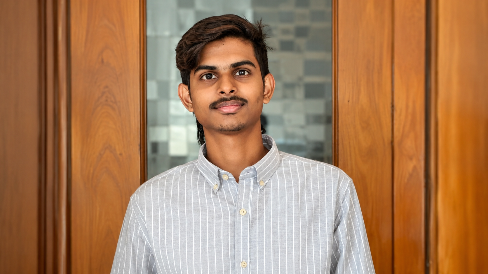

### BUILDING INTELLIGENT SYSTEMS. EXPLORING WHAT'S NEXT.

---

## 👨‍💻 WHO AM I?

I'm **Ajeem Suban**, a B.Tech Artificial Intelligence and Data Science student at **Dhanalakshmi Srinivasan University**, graduating in 2028.

I enjoy building practical AI systems, experimenting with emerging technologies, and turning technical ideas into usable software.

- 🧠 Exploring AI, Machine Learning and RAG
- 🤖 Building AI agents and intelligent applications
- 🔒 Interested in local-first and privacy-conscious AI
- 👁️ Exploring computer vision
- ⚙️ Developing software engineering automation systems

 

---

## 🚀 PROJECT UNIVERSE

_Different ideas. Different challenges. One continuous journey of building._

### 

**Tamil Literature Intelligence Platform**

A Tamil-first platform for semantic search across classical Tamil literature, translation, and document OCR through its KalVettu module. It uses retrieval-grounded results to connect users with source material.

`Python` `FastAPI` `React` `ChromaDB` `IndicTrans2`

[↗ Explore TAMIL-AI.ME](https://github.com/ajeem-suban/Project-TAMIL-AI.ME)

---

### 

**AI Intelligent Emergency Response System**

An emergency response decision-support system using real Trichy OpenStreetMap road data. Includes ambulance routing, hospital selection, simulated road disruptions, and live route updates through WebSockets.

`Python` `FastAPI` `WebSocket` `OpenStreetMap`

[↗ Explore AIRES-AI](https://github.com/ajeem-suban/AIRES-AI)

---

### 

**AI Student Project Orchestrator**

An AI-powered software engineering platform designed to help students transform project ideas into structured software. Supports research, requirements, architecture, implementation, testing, debugging, and human approval workflows.

⚡ Actively under development

`Python` `FastAPI` `React` `TypeScript` `AI Orchestration`

[↗ Explore ROGERS](https://github.com/ajeem-suban/ROGERS)

---

### 

**Local-First AI Productivity & Knowledge Management**

A personal second-brain platform combining AI chat, knowledge management, and intelligent retrieval with a local-first architecture.

`Python` `FastAPI` `React` `SQLite` `ChromaDB` `Ollama`

[↗ Explore SECRAIN](https://github.com/ajeem-suban/SECRAIN)

---

### 

**Personal AI & Computer Vision Experiments**

An experimental local AI project focused on face detection, facial analysis, embedding extraction, and identity-comparison utilities. Personalized image generation is a future development goal.

🔬 Recognition accuracy is still being evaluated.

`Python` `InsightFace` `ONNX Runtime` `OpenCV` `NumPy`

[↗ Explore CULLINAN](https://github.com/ajeem-suban/cullinan-ai)

---

### 

**Voice-First Personal AI Assistant**

A personal assistant project focused on voice-based interaction, understanding user commands, and connecting conversational AI with practical assistant workflows.

[↗ Explore TITAN ASSISTANT](https://github.com/ajeem-suban/TITAN-ASSISTANT)

---

## 🧰 TECHNOLOGY & TOOLS

### Languages

### AI / ML / Data

### Backend / Frontend

### Development Tools

---

## 📊 GITHUB ACTIVITY

### Contribution Graph

<picture>
  <source media="(prefers-color-scheme: dark)" srcset="https://raw.githubusercontent.com/ajeem-suban/ajeem-suban/output/github-contribution-grid-snake-dark.svg"/>
  <source media="(prefers-color-scheme: light)" srcset="https://raw.githubusercontent.com/ajeem-suban/ajeem-suban/output/github-contribution-grid-snake.svg"/>
  
</picture>

---

## 🎯 CURRENT FOCUS

- Building ROGERS into a capable AI software engineering orchestrator.
- Improving Tamil language technology through TAMIL-AI.ME.
- Exploring local AI, computer vision, and personalized AI systems.
- Strengthening practical AI/ML engineering skills.

---

## 🎓 EDUCATION

**B.Tech — Artificial Intelligence and Data Science**

Dhanalakshmi Srinivasan University

**Expected Graduation: 2028**

---

### LET'S BUILD SOMETHING MEANINGFUL.

**BUILD · LEARN · EXPERIMENT · IMPROVE**

[Portfolio](https://ajeem-suban.vercel.app/) · [LinkedIn](https://www.linkedin.com/in/ajeem-suban/) · [Hugging Face](https://huggingface.co/AJEEM-SUBAN)

