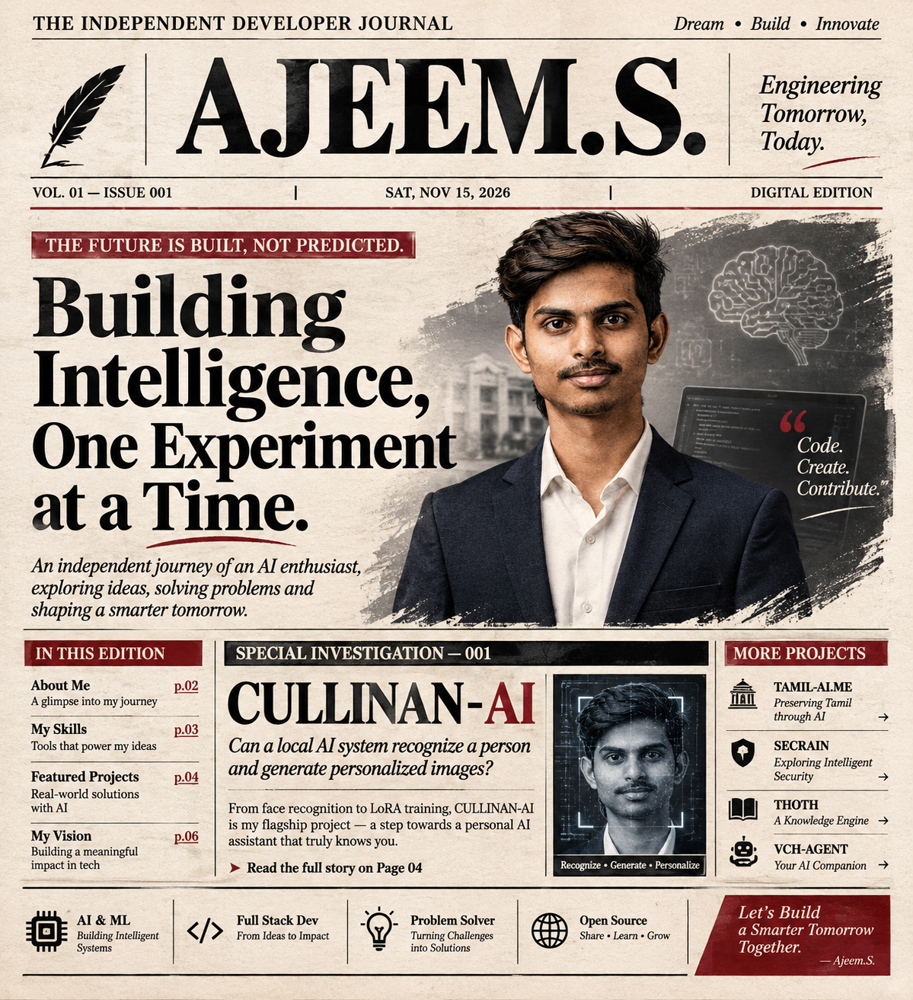

<!-- ═══════════════════════ COVER ═══════════════════════ -->

<p align="center">
  
</p>

<h1 align="center">AJEEM.S</h1>

<p align="center">
  <code>AI & DATA SCIENCE DEVELOPER</code> &nbsp;·&nbsp; <code>AI/ML ENGINEER</code> &nbsp;·&nbsp; <code>NLP & INTELLIGENT SYSTEMS</code>
</p>

<p align="center">
  
</p>

<p align="center">
  <a href="https://ajeem-suban.vercel.app/">
    
  </a>
  <a href="mailto:ajeemsuban060@gmail.com">
    
  </a>
  <a href="https://www.linkedin.com/in/ajeem-suban/">
    
  </a>
  <a href="https://huggingface.co/AJEEM-SUBAN">
    
  </a>
  
</p>


<!-- ═══════════════════════ CASE FILE ═══════════════════════ -->

<h2 align="center">🩸 &nbsp;CASE FILE #001 — THE DEVELOPER</h2>


**Subject:** AJEEM.S &nbsp;·&nbsp; **Status:** `BUILDING`

A third-year **Artificial Intelligence & Data Science** undergraduate at Dhanalakshmi Srinivasan University, India.

I build practical AI systems that combine machine learning, natural language processing, intelligent agents, and software engineering.

My work focuses on solving real-world problems through independent experimentation, system design, and continuous evaluation.
```

> AI / ML ........ Python · PyTorch · Machine Learning
> NLP ............ Tamil NLP · RAG · OCR · Embeddings
> Backend ........ FastAPI · Flask · REST APIs
> Data ........... Data Science · ChromaDB · SQLite
> AI Systems ..... Local AI · LLMs · Intelligent Agents
> Investigating .. AI engineering · MLOps · Model evaluation

```

From building Tamil-first language technology to experimenting with personalized image generation, I approach every project as an engineering problem.

**Build systems that work. Understand why they work. Improve what doesn't.**

<br clear="right"/>


<!-- ═══════════════════════ TOOLS ═══════════════════════ -->

<h2 align="center">🔪 &nbsp;THE TOOL KIT</h2>

<p align="center">
  
</p>
<p align="center">
  
</p>
<p align="center">
  
</p>

<p align="center">
  
</p>

<p align="center">
  <sub><code>PYTHON</code> &nbsp; <code>RAG</code> &nbsp; <code>LLMs</code> &nbsp; <code>CHROMADB</code> &nbsp; <code>INSIGHTFACE</code> &nbsp; <code>OLLAMA</code> &nbsp; <code>INDIC NLP</code></sub>
</p>


<!-- ═══════════════════════ FORENSICS ═══════════════════════ -->

<h2 align="center">🔬 &nbsp;FORENSIC REPORT</h2>

<p align="center"><i>A technical snapshot of my GitHub activity, repository distribution, programming languages, and development consistency.</i></p>

<p align="center">
  
  &nbsp;
  
</p>

<p align="center">
  
  &nbsp;
  
</p>

<h3 align="center">📉 &nbsp;VOLUME ANALYSIS</h3>

<p align="center"><i>Repository activity and contribution patterns, generated from GitHub data.</i></p>

<p align="center">
  
</p>

<p align="center">
  
</p>

<p align="center">
  
</p>

<h3 align="center">🌍 &nbsp;FIELD WORK — UPSTREAM CONTRIBUTIONS</h3>

<p align="center"><i>Open-source contributions and collaborative engineering activity.</i></p>

<p align="center">
  
</p>

<p align="center">
  
</p>

<details>
<summary><b>🔎 &nbsp;OPEN THE FULL EVIDENCE LOG</b> — repository and contribution details</summary>

<br clear="all"/>

> Repository metrics and contribution records should be synchronized directly with the GitHub API.

<!-- DATA-TABLES:START -->

**Profile:** `ajeem-suban` · **Source:** GitHub API

#### Repositories

| Metric | Count |
| :-- | --: |
| Public repositories | To be synchronized |
| Source repositories | To be synchronized |
| Forked repositories | To be synchronized |
| Stars earned | To be synchronized |
| Followers | To be synchronized |

#### Contributions per month

| Metric | Value |
| :-- | --: |
| Monthly contributions | To be synchronized |

#### Contributions by weekday

| Day | Contributions |
| :-- | --: |
| To be synchronized | — |

#### Contribution mix

| Type | Count |
| :-- | --: |
| Commits | — |
| Pull Requests | — |
| Issues | — |
| Repositories created | — |

#### Languages

| Language | Distribution |
| :-- | --: |
| To be synchronized | — |

#### Projects

| Project | Focus |
| :-- | :-- |
| TAMIL-AI | Tamil NLP and RAG |
| CULLINAN-AI | Face recognition and personalized image generation |
| SECRAIN | Local-first AI second brain |
| THOTH | Knowledge and learning automation |
| TITAN | Personal AI workspace |
| VCH-AGENT | Predictive content intelligence |

<!-- DATA-TABLES:END -->

</details>

<h3 align="center">📈 &nbsp;ACTIVITY TIMELINE</h3>

<p align="center">
  
</p>


<!-- ═══════════════════════ EVIDENCE ═══════════════════════ -->

<h2 align="center">📁 &nbsp;EVIDENCE — SELECTED WORK</h2>

<table align="center">
  <tr>
    <td width="50%" valign="top">
      <h4>🌐 &nbsp;TAMIL-AI.ME</h4>
      <p>Tamil-first AI platform combining NLP, retrieval-augmented generation, translation, and historical Tamil inscription OCR.</p>
      <sub><code>Python</code> <code>Indic NLP</code> <code>RAG</code> <code>ChromaDB</code></sub>
      <br/><br/>
      <a href="https://tamil-ai.me">Explore Project</a>
    </td>
    <td width="50%" valign="top">
      <h4>🧬 &nbsp;CULLINAN-AI</h4>
      <p>Personal AI system combining facial recognition and personalized image generation using identity-focused LoRA training.</p>
      <sub><code>Python</code> <code>InsightFace</code> <code>PyTorch</code> <code>LoRA</code></sub>
    </td>
  </tr>
  <tr>
    <td width="50%" valign="top">
      <h4>🧠 &nbsp;SECRAIN</h4>
      <p>Local-first AI second brain designed for personal knowledge management, retrieval, and intelligent information access.</p>
      <sub><code>FastAPI</code> <code>React</code> <code>SQLite</code> <code>ChromaDB</code></sub>
      <br/><br/>
      <a href="https://github.com/ajeem-suban/SECRAIN">Explore Repository</a>
    </td>
    <td width="50%" valign="top">
      <h4>📚 &nbsp;THOTH</h4>
      <p>Automated knowledge and learning bot delivering structured daily educational content through Telegram.</p>
      <sub><code>Python</code> <code>Telegram API</code> <code>Wikipedia</code> <code>Wikidata</code></sub>
    </td>
  </tr>
  <tr>
    <td width="50%" valign="top">
      <h4>âš¡ &nbsp;TITAN</h4>
      <p>Personal AI workspace exploring intelligent assistance and a unified interaction experience.</p>
      <sub><code>Python</code> <code>LLMs</code> <code>AI Agents</code></sub>
    </td>
    <td width="50%" valign="top">
      <h4>🔮 &nbsp;VCH-AGENT</h4>
      <p>Predictive content intelligence project exploring AI-assisted content analysis and decision-making.</p>
      <sub><code>Python</code> <code>Machine Learning</code> <code>AI Agents</code></sub>
    </td>
  </tr>
  <tr>
    <td width="50%" valign="top">
      <h4>🛡️ &nbsp;ROGERS</h4>
      <p>Software project focused on building practical intelligent applications and engineering solutions.</p>
      <sub><code>Python</code> <code>Software Engineering</code></sub>
    </td>
    <td width="50%" valign="top">
      <h4>🚨 &nbsp;AIRES</h4>
      <p>AI-based emergency dispatch prototype exploring intelligent emergency-response workflows.</p>
      <sub><code>Python</code> <code>AI</code> <code>Predictive Systems</code></sub>
    </td>
  </tr>
</table>


<!-- ═══════════════════════ ARCADE ═══════════════════════ -->

<h2 align="center">🕹 &nbsp;THE HUNT — CONTRIBUTION ARCADE</h2>

<p align="center"><i>My contribution grid, played four different ways. Regenerated automatically.</i></p>

<h3 align="center">🐍 &nbsp;Snake</h3>

<p align="center">
  <picture>
    <source media="(prefers-color-scheme: dark)" srcset="https://raw.githubusercontent.com/ajeem-suban/ajeem-suban/output/snake-dark.svg">
    <source media="(prefers-color-scheme: light)" srcset="https://raw.githubusercontent.com/ajeem-suban/ajeem-suban/output/snake.svg">
    
  </picture>
</p>

<h3 align="center">👻 &nbsp;Pac-Man</h3>

<p align="center">
  <picture>
    <source media="(prefers-color-scheme: dark)" srcset="https://raw.githubusercontent.com/ajeem-suban/ajeem-suban/output/pacman-contribution-graph-dark.svg">
    <source media="(prefers-color-scheme: light)" srcset="https://raw.githubusercontent.com/ajeem-suban/ajeem-suban/output/pacman-contribution-graph.svg">
    
  </picture>
</p>

<h3 align="center">🧱 &nbsp;Breakout</h3>

<p align="center">
  <picture>
    <source media="(prefers-color-scheme: dark)" srcset="https://raw.githubusercontent.com/ajeem-suban/ajeem-suban/output/breakout-contribution-graph-dark.svg">
    <source media="(prefers-color-scheme: light)" srcset="https://raw.githubusercontent.com/ajeem-suban/ajeem-suban/output/breakout-contribution-graph.svg">
    
  </picture>
</p>

<h3 align="center">🚀 &nbsp;Galaga</h3>

<p align="center">
  <picture>
    <source media="(prefers-color-scheme: dark)" srcset="https://raw.githubusercontent.com/ajeem-suban/ajeem-suban/output/galaga-contribution-graph-dark.svg">
    <source media="(prefers-color-scheme: light)" srcset="https://raw.githubusercontent.com/ajeem-suban/ajeem-suban/output/galaga-contribution-graph.svg">
    
  </picture>
</p>


<!-- ═══════════════════════ CODE ═══════════════════════ -->

<h2 align="center">🧬 &nbsp;THE CODE</h2>

<p align="center">
  
</p>

<p align="center">
  <sub><code>RESEARCH. &nbsp;ENGINEER. &nbsp;EVALUATE. &nbsp;EVOLVE.</code></sub>
</p>

<p align="center">
  <i>⭐ Building intelligent systems that solve meaningful real-world problems.</i>
</p>


```
